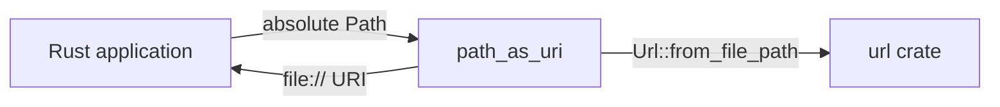

# Architecture of path_as_uri

Reviewed against the code on 2026-11-28.

## Context

A Rust application calls the library with an absolute `Path` and gets a `file://` URI back, as a `url::Url` or a `String`. The library has no I/O: it does not touch the filesystem, it only converts. It is published on crates.io; docs.rs holds the API reference.

## Containers

One library crate, no binary. `src/lib.rs` holds the three public functions and `PathAsUriError` (via `thiserror`); `src/tests.rs` holds the unit tests. Every public function has a doc test, so the README example and the docs.rs page run in CI on Linux, macOS and Windows.

## Invariants

- A relative path is never turned into a URI: `*_or_error` returns `PathAsUriError::NotAbsolute`, the short form panics with the path in the message.
- Encoding is the `url` crate's job; the library never builds the string by concatenation.
- No `unsafe`, no `unwrap` outside tests (`Cargo.toml [lints]`, the gate makes warnings errors).

## Where to start reading

- `src/lib.rs`: the three functions and the error type, with doc tests.
- `src/tests.rs`: unit tests, including spaces and relative paths.
- `.github/workflows/ci.yml` and `release.yml`: the gate and the crates.io release by trusted publishing.
